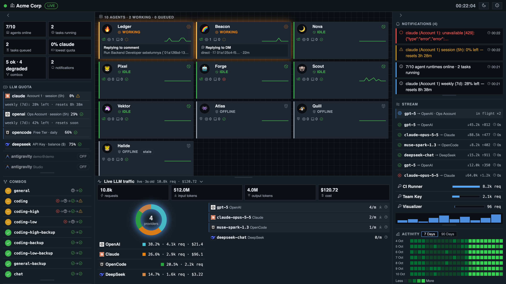

# AI Workspace Monitoring

A command-center dashboard for your AI team: who is working / queued / idle / error,
remaining LLM quota, 9Router combo health, and live traffic — in one screen, no tab-hopping.



## What it connects to

| Source | What you get | Required |
|---|---|---|
| [9Router](https://9router.com) (self-hosted) | LLM quota per account, combo fallback health, live request/token stream | `NINEROUTER_URL` + dashboard password (auto-login) |
| [Multica](https://multica.ai) (cloud) | Agents, runtimes, task queues, run history | `MULTICA_TOKEN` + `MULTICA_WORKSPACE` |
| AWS ECS | Desired vs running worker services | Optional — hidden when unconfigured; the Runtimes panel stays the source of truth |

Without tokens, every source degrades to clearly-labeled mock data so the UI can still be evaluated
(`MOCK_TOTAL=1` serves a full public-safe demo — see `scripts/build_mock.py`).

## Layout

Viewport-locked IDE: collapsible left/right panels squeeze the canvas (never overlay),
collapsible bottom dock for live traffic, modals for every agent/runtime/combo/provider.
Dark/light mode, English UI, Phosphor icons, keyboard accessible.

## Quickstart

```bash
cp .env.example .env   # fill tokens; .env is gitignored
python3 -m venv .venv && ./.venv/bin/pip install -r requirements.txt
brew install multica-ai/tap/multica   # CLI for live Multica data (macOS; see Multica docs for Linux)
set -a; source .env; set +a
./.venv/bin/python -m collector.main  # open http://localhost:8080/
```

Frontend is React + Vite (`web/`). After UI changes: `npm run build --prefix web`
(or `cd web && npm install && npm run dev` for hot reload).

Docker: `docker compose up --build` (see [docs/operations.md](docs/operations.md)).
Images: `ghcr.io/proreka/ai-workspace-monitoring` (see [Releases](https://github.com/ProReka/ai-workspace-monitoring/releases)).

## Docs

- [docs/architecture.md](docs/architecture.md) — data flow
- [docs/api.md](docs/api.md) — collector endpoints + JSON shapes
- [docs/sources.md](docs/sources.md) — 9Router & Multica integration notes
- [docs/operations.md](docs/operations.md) — run/deploy, roadmap
- [AGENTS.md](AGENTS.md) — working rules for AI agents · [CONTRIBUTING.md](CONTRIBUTING.md) — how to contribute

## License

MIT — see [LICENSE](LICENSE).
